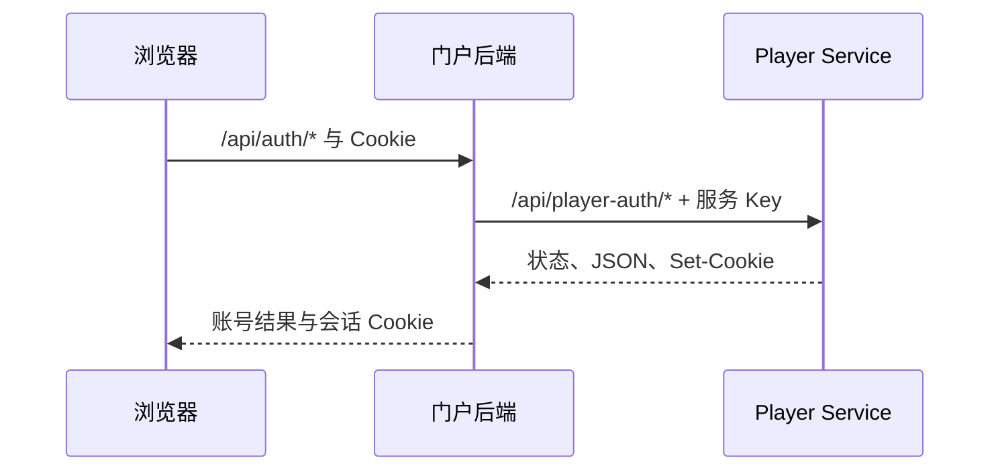

# 玩家登录门户

TypeScript / React 登录页与 Node 后端，提供注册、登录、退出、昵称和密码修改。账号、会话与密码哈希由 Player Service 管理，门户不另建数据库。



## 启动预览

| 场景             | 安装与启动                                                                      |
| ---------------- | ------------------------------------------------------------------------------- |
| 引擎工作区       | 根 `npm run install:all`，再执行 `npm --prefix apps/player-auth-portal run dev` |
| 已导出的独立模板 | Node.js 22.17 或更新版本，模板根运行 `npm ci`、`npm run dev`                    |
| 真实服务联调     | 模块根配置 `.env`，运行 `npm run dev:live`                                      |

模拟预览默认 `http://127.0.0.1:4325`，账号 `demo` / `demo-password-123`，数据只在内存中。普通预览不连接真实账号服务，也不验证真实设备、封禁、限流或数据库行为。

根 `npm run dev:infra` 则启动引擎整套服务，登录门户默认地址是 `3125`。

## 修改位置

| 位置                                  | 职责                               |
| ------------------------------------- | ---------------------------------- |
| `src/app.tsx`、`forms.tsx`、`styles/` | 页面、表单和主题                   |
| `src/client.ts`                       | 浏览器六种账号操作与错误处理       |
| `server/config.ts`                    | 地址、开关、来源与回跳规则         |
| `server/auth.ts`                      | 固定账号操作、策略和上游代理       |
| `server/http.ts`、`portal.ts`         | 正文限制、静态文件、路由和生命周期 |
| `scripts/tasks.ts`、`mock.ts`         | 构建、打包、导出与模拟服务         |
| `public/`                             | HTML 和品牌资源                    |

`public/app.js`、`theme.js`、`styles.css`、`build/` 为生成物。修改源文件，不直接修补生成结果。接口用法见[接口与定制指南](docs/API.md)。

## 模块命令

以下在模块目录或导出的独立模板根执行：

| 命令                                   | 用途                         |
| -------------------------------------- | ---------------------------- |
| `npm run dev` / `dev:live`             | 模拟预览 / 真实联调          |
| `npm run typecheck`、`npm test`        | 类型与账号/HTTP 回归         |
| `npm run build`、`npm start`           | 编译 / 启动生产入口          |
| `npm run check`                        | 类型、构建与测试             |
| `npm run package`                      | 构建 Docker 镜像并导出归档   |
| `npm run export:template`              | 导出独立模板源码             |
| `npm run test:ui -- --electron <路径>` | 使用已有 Electron 做页面回归 |

生产入口为 `build/server.cjs`，可复用类位于 `build/library.cjs`，声明位于 `build/types/server/index.d.ts`。生产启动缺少配置会失败，不启动模拟器。

## 打包与部署

```sh
npm run package -- --image my-login:1.0 --platform linux/arm64
docker load -i dist/my-login-1.0-linux-arm64.tar.gz
```

AMD64 使用 `--platform linux/amd64`。在部署管理器“数据配置 → 访问设置 → 登录页面镜像”填入本机镜像名。地址、Key 和注册开关由运行配置注入，不写入镜像。

独立模板使用 `Dockerfile.standalone`；引擎工作区使用集成 Dockerfile。运行镜像仅含编译后端与页面，监听 `0.0.0.0:3214`，非 root、可只读运行，健康接口只检查门户自身。

自定义镜像不会自动拉取或随引擎升级；每次发布使用新 tag。归档同名时默认拒绝覆盖，需显式 `--force`。此归档只有登录门户，不是完整引擎镜像包。

## 运行约束

- 服务 Key 仅在门户后端使用；只代理固定六种账号操作，不接受任意 URL。
- 写请求检查 Origin，JSON 最大 32 KiB；改昵称/密码只操作当前会话。
- 转发 Cookie、逐条 Set-Cookie、上游状态和 Retry-After；不缓存账号响应。
- 回跳只允许配置的 Creator / Play 源；密码不持久化，改密成功后重新登录。
- 独立公网地址使用一次性登录码共享会话，不要求统一域名。自定义页面须保留 `source`、`returnUrl`、`transferState`、`transferChallenge`，登录或查询会话后使用后端返回的 `returnUrl` 跳转；不要自行拼接回跳地址。
- 静态文件限制在 `public/`，校验真实路径，不公开 `.env` 和源码。

跨站登录流程及更新要求见[架构与数据流](../../docs/architecture.md#独立公网登录)。登录门户、Player Service、Play 和 Creator 需同步更新。

导出模板使用 `npm run export:template`，得到 `dist/box3-login-template-<版本>.tar.gz`。模板包含源码、锁文件、测试与文档，不含本机数据。许可见 [MIT](LICENSE)，品牌与第三方资源遵循各自约定。
