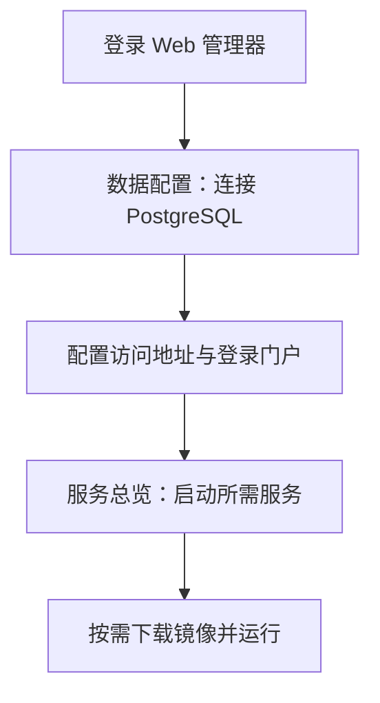

# Linux 服务器安装与运维

适用于无桌面的 Linux AMD64 / ARM64。运行只需 Docker Engine 和 Compose v2，无需源码、Node.js 或 Rust。服务器包包含脚本、配置和清单；管理器及业务镜像按需下载。

## 安装

| 方式         | 操作                                                          | 管理端默认访问                          |
| ------------ | ------------------------------------------------------------- | --------------------------------------- |
| 联网一键安装 | 执行下方命令                                                  | 开放 TCP `3130`，需配置防火墙与访问保护 |
| 已下载 ZIP   | 完整解压，执行 `chmod +x *.sh`、`./verify.sh`、`./install.sh` | `127.0.0.1:3130`，使用 SSH 隧道         |

```sh
curl -fsSL https://assets.box3.fun/local-engine/install.sh | sudo bash
```

推荐 Ubuntu、Debian 或 Alibaba Cloud Linux 3 / 4，需稳定的 `/etc/machine-id`。`x86_64` 对应 AMD64，`aarch64` / `arm64` 对应 ARM64。

| 用途                   | CPU      | 内存       | 可用磁盘 |
| ---------------------- | -------- | ---------- | -------- |
| 仅管理端               | 1 核     | 1 GB       | 10 GB    |
| 小规模 Play + 玩家服务 | 4 核     | 8 GB       | 30 GB    |
| Creator、VOXA、Play    | 8 核以上 | 16 GB 以上 | 50 GB 起 |

安装时保留终端显示的地址和密钥：`BOX_SERVER_MANAGER_TOKEN` 登录 Web 管理器；`BOX_PLAY_ADMIN_TOKEN` 登录玩家后台。两者不能互换。升级安装不覆盖已有 `.env`。

仅本机访问的一键安装方式：

```sh
curl -fsSL https://assets.box3.fun/local-engine/install.sh -o install.sh
sudo BOX3_MANAGER_BIND_IP=127.0.0.1 sh install.sh
```

## 登录与启动服务

仅本机监听时，在自己的电脑运行：

```sh
ssh -L 3130:127.0.0.1:3130 <服务器用户>@<服务器地址>
```

保持连接，打开 `http://127.0.0.1:3130`。管理令牌位于服务器部署目录 `.env`；只在私密终端读取。



PostgreSQL 可用内置实例或外部服务；Redis 可选。启用 HTTPS 才下载托管 Nginx。`.env` 是维护配置，`.runtime.env` 由管理器生成；不要手工修改后者。保留创建数据库卷时使用的账号与密码。

## 网络与资源

| 端口           | 用途           | 访问范围                            |
| -------------- | -------------- | ----------------------------------- |
| `3130`         | Web 管理器     | SSH 隧道、HTTPS、VPN 或来源 IP 限制 |
| `3121`、`3125` | 游玩与登录门户 | 面向玩家时通过 HTTPS                |
| `3124`         | Player Service | 仅按需代理玩家 API，不公开管理路由  |
| `3127`、`3123` | Creator、VOXA  | 本机或可信创作者网络                |
| `5432`、`6379` | 数据库与 Redis | 本机或容器内部                      |
| 内部运行时端口 | 地图状态与脚本 | 不直接对外开放                      |

管理器可访问 Docker Socket，管理权限等同于控制宿主机。只运行可信镜像，保护管理令牌。小服务器可只启动 Play，关闭不需要的门户/Redis，并将预热运行时数量设为 `0`；资源上限以 `.env.example` 为准。

## 日常运维与升级

在部署目录执行：

| 命令                 | 用途                                                                |
| -------------------- | ------------------------------------------------------------------- |
| `./status.sh`        | 查看服务状态                                                        |
| `./start.sh`         | 启动 Web 管理器，业务服务由页面启动                                 |
| `./logs.sh <服务名>` | 跟踪日志，如 `server-manager`、`player-service`、`managed-postgres` |
| `./stop.sh`          | 停止服务，保留数据                                                  |
| `./install.sh`       | 校验文件、准备管理器镜像并启动，不覆盖配置                          |

升级前备份 `.env`、`apps/local-engine/{projects,play-worlds,backups}/` 和 `apps/voxa/data/`，另做 PostgreSQL 备份。迁移到新目录时先停旧服务，复制配置与数据，再运行新包的校验和安装。不要删除数据库卷排障。

| 现象                 | 检查                                       |
| -------------------- | ------------------------------------------ |
| 管理页面打不开       | SSH 隧道、防火墙、`status.sh` 和管理器日志 |
| 令牌或数据库账号无效 | 当前部署 `.env` 与原数据库卷凭据           |
| Player Service 503   | 身份服务与 PostgreSQL 日志                 |
| 镜像下载失败         | 网络、代理、镜像源与磁盘空间               |
| 容器因内存不足退出   | 日志和对应 `*_MEMORY_LIMIT`                |

维护者补打服务器包时复用已发布应用镜像，仅构建 Web 管理器镜像。发布入口见[发布与版本](../../docs/release-and-version.md)。
