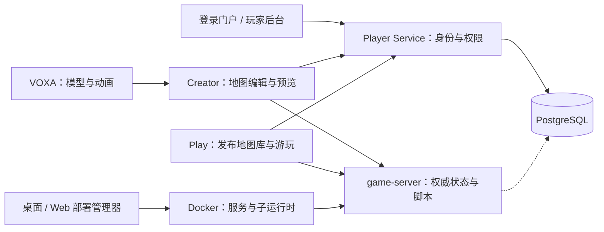
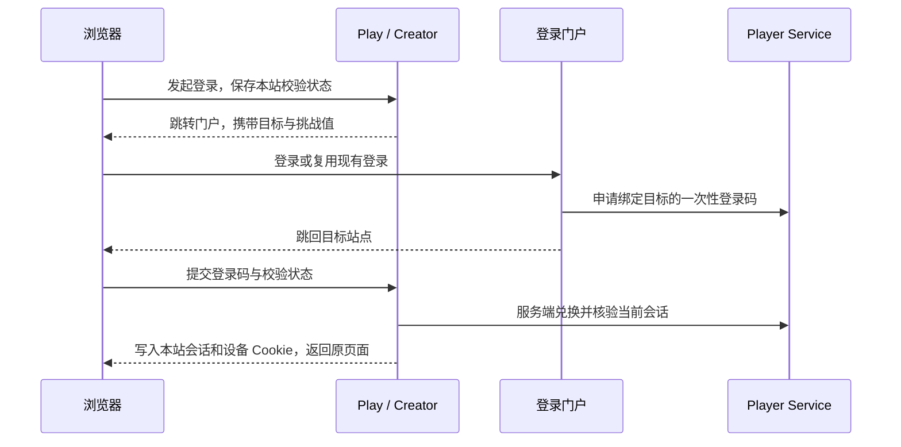

# 架构与数据流

项目由浏览器编辑器、身份服务、权威运行时和部署管理器组成，使用 Rush 管理工作区。源码开发启动本机进程；发行部署通过 Docker 启动服务和地图子运行时。

## 服务关系

Creator、Play 和 Player Service 共用 `apps/game` 的网页与 HTTP 实现，按模式生成不同产物。浏览器通过同源入口访问资源、会话和 WebSocket，服务再转发到内部运行时；内部控制端口不直接对玩家开放。

Player Service 保存账号、管理权限、封禁和审计。地图脚本 storage 使用独立命名空间。Redis 可用于会话、限流与缓存；本地回退不能代替玩家身份数据库。

### 独立公网登录

Play、Creator 和登录门户可分别使用不同域名、IP、端口和入口路径。跨源登录通过浏览器顶层跳转完成，不依赖第三方 Cookie。

登录码有效期 60 秒、仅兑换一次；浏览器校验状态有效期 5 分钟。目标站点写入同一玩家会话及设备凭证，退出、改密和会话撤销仍统一生效。数据库只保存登录码哈希与加密凭证，长期会话不进入跳转 URL。

更新时需同步部署 Play、Creator、Player Service 和登录门户。自定义登录镜像需同步最新模板中的登录交换协议；公网地址由配置决定，不信任浏览器提供的回调地址。

## 代码位置

| 目录                                                              | 职责                                              |
| ----------------------------------------------------------------- | ------------------------------------------------- |
| `apps/game`                                                       | Creator / Play 页面、Player Service API、同源转发 |
| `apps/local-engine`                                               | 工程、快照、地图组、导入导出和运行时生命周期      |
| `services/game-server`                                            | 权威实体与体素、脚本隔离、storage、反作弊         |
| `apps/voxa`                                                       | 模型、皮肤、动画与模型库存储                      |
| `apps/player-admin`、`apps/player-auth-portal`                    | 管理界面与玩家登录门户                            |
| `apps/deployment-manager`                                         | 共用管理界面与 Tauri 桌面适配                     |
| `apps/server-manager-rust`、`apps/manager-core`                   | Web 管理适配与两端共享部署规则                    |
| `apps/player-launcher`                                            | Electron 玩家客户端、服务器连接与缓存             |
| `internals/apis`                                                  | HTTP 契约、OpenAPI 和生成客户端                   |
| `internals/schema`、`packages/script-api`                         | 场景协议与地图脚本类型                            |
| `packages/player-policy`、`realtime-client`、`deployment-routing` | 授权策略、实时连接与地址前缀                      |
| `scripts`、`distribution`                                         | 根任务、构建脚本与发行模板                        |

渲染、建模和底层协议还分布在 `internals/`、`packages/`。跨应用复用通过包入口，避免直接导入另一应用的源码。

## 作品与身份术语

| 名称                       | 含义                                               |
| -------------------------- | -------------------------------------------------- |
| 工程 / project             | Creator 中可编辑的地图及源状态                     |
| 地图组                     | 一个主地图与多个可选副地图；共享组资源和组数据空间 |
| 工程 ID                    | Creator 编辑入口的标识，导入时可能重分配           |
| 永久地图 ID                | 稳定的地图与存储标识                               |
| 访问 ID / publicId         | `/p/<publicId>` 中可修改的 URL 名称                |
| 发布快照                   | 不可变地图版本，后续编辑不会自动更新它             |
| `.boxproject` / `.boxplay` | 可编辑备份 / 不含 `source/` 的发布游玩包           |
| blob                       | 按内容哈希定位的资源或序列化数据                   |
| 服主 / 管理员 / 创作者     | 令牌管理身份 / 权限组管理账号 / 获授权的玩家       |

服主通过 `BOX_PLAY_ADMIN_TOKEN` 初始化后台，给玩家授予创作权限。玩家登录门户不负责创建后台管理员；客户端隐藏按钮也不能替代服务端授权。

## 数据放在哪里

| 环境或内容               | 位置                                                          |
| ------------------------ | ------------------------------------------------------------- |
| 源码开发工程与资源       | `.local-data/apps/local-engine/`                              |
| 源码开发模型             | `.local-data/apps/voxa/data/`                                 |
| 内置资源与构建缓存       | `apps/local-engine/data/blobs/` / `.local-data/build-assets/` |
| Docker 部署              | `BOX_DATA_DIRECTORY` 下的应用目录与数据库卷                   |
| 桌面部署                 | 系统应用数据目录中的 `runtime/`                               |
| 账号、权限和脚本持久数据 | 配置的 PostgreSQL                                             |

`.local-data/` 不提交 Git、不进入镜像。开发数据根可通过 `BOX_DEV_DATA_DIRECTORY` 调整；旧数据首次迁移不覆盖非空目标。作品包和管理器文件备份都不包含外部 PostgreSQL 备份。

作品操作见[首个作品教程](first-project.md)，端口与配置见[开发入门](developer-guide.md)，模块 README 入口见[文档导航](README.md)。
