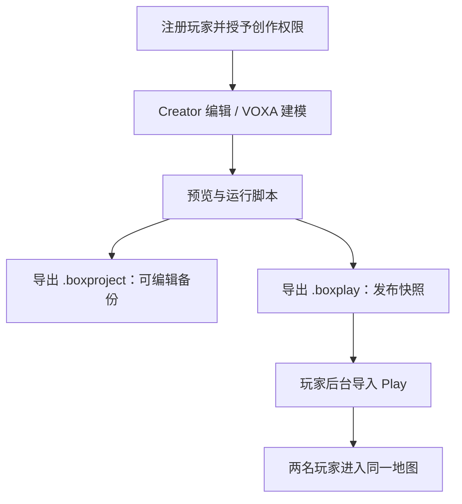

# 首个作品：从编辑到游玩

使用本机源码栈完成授权、制作、备份和发布。安装环境见[开发入门](developer-guide.md)。教程统一使用 `127.0.0.1`，不要与 `localhost` 混用 Cookie。



## 1. 配置服主并启动

首次在仓库根目录执行；已有 `.env` 时跳过复制：

```sh
npm run install:all
cp .env.docker.example .env
node -e "console.log(require('node:crypto').randomBytes(32).toString('hex'))"
```

把生成值填入根 `.env` 的 `BOX_PLAY_ADMIN_TOKEN=`，再执行：

```sh
npm run check:workspace
npm run dev:infra
```

PowerShell 用 `Copy-Item` 复制配置。服主令牌至少 16 字符，与 Web 管理器令牌及服务 API Key 不同；修改后需重启源码栈。等待数据库和服务就绪，保持终端运行。

## 2. 注册玩家与授权

| 步骤       | 操作                                                          |
| ---------- | ------------------------------------------------------------- |
| 注册玩家 A | 打开 `http://127.0.0.1:3125/`，创建测试玩家                   |
| 服主登录   | 打开 `http://127.0.0.1:8000/`，选择“服主登录”，输入上面的令牌 |
| 允许创作   | “创作管理 → 创作权限 → 新增”，选择玩家 A 并开启创作端         |
| 授予能力   | 保留新建、编辑、导入、导出工程及管理模型能力                  |

需要日常管理账号时，在“服主管理”先建权限组，再建独立管理账号，初始密码至少 12 位。普通玩家密码不能用于“管理员登录”。本教程后续后台操作继续使用服主身份。

## 3. 创建地图并预览脚本

用已登录玩家 A 的浏览器打开 `http://127.0.0.1:3127/projects`，选择“新建作品”，填写名称，选择“小（32×32×32）”。进入编辑器，放置少量体素。

打开“脚本”的服务端入口 `index.js`，加入：

```js
console.log('首个作品：脚本已启动');
world.onPlayerJoin(({ entity }) => {
    world.say('欢迎来到我的首个本地作品');
    console.log('玩家加入', entity.player.name);
});
```

点击运行，应看到欢迎消息与脚本日志。修改后先停止再运行；不要把服务端示例放到 `clientIndex.js`。Creator 的 `/p/<project-id>` 仍是工程预览，不代表已发布到 Play。

可选模型：在“模型 → 项目模型库”中新建模型，使用 VOXA“体建造”画一个方块，点击保存后返回地图放置并预览。只有模型卡片、没有保存工程与 mesh，不能证明发布资源完整。

## 4. 备份可编辑工程

地图列表中选择“更多操作 → 导出 → 导出地图组工程”，保存 `.boxproject` 到仓库外。单地图也可导出本地图；有副地图时使用地图组导出。

点击“导入工程”，选择备份，“作为独立地图组 → 开始导入”。打开导入后的作品，检查体素、脚本和模型并运行。保留原作品，确认恢复后仍用原作品发布。

## 5. 发布并导入 Play

| 步骤           | 操作                                                                   |
| -------------- | ---------------------------------------------------------------------- |
| 导出发布包     | 原主地图“更多操作 → 导出 → 导出游戏包”                                 |
| 设置版本与资源 | 首次填写 `v1.0.0`，选择“仅本地资源”，保存 `.boxplay`                   |
| 检查并导入     | 玩家后台“游玩管理 → 游玩地图 → 导入游玩包”，查看脚本、媒体与版本后确认 |
| 开放地图       | 检查地图组状态为“开放”；可通过“设置”修改访问 ID                        |
| 游玩           | 打开后台提供的 `http://127.0.0.1:3121/p/<publicId>`                    |

`.boxplay` 保存不可变发布快照，不含可编辑 `source/`；后续编辑工程不会自动更新已导入版本。再次发布使用新版本号。选择“仅本地资源”无需配置 OSS；脚本预览只展示内容，不执行脚本。

## 6. 两名玩家与重启验收

玩家 A 先进入 Play。另一浏览器或独立配置文件注册玩家 B，进入同一地图公共实例，应能看到彼此。两个普通标签页通常共享登录，不能当作两个玩家环境。

关闭预览与玩家窗口，源码终端按 Ctrl+C，再运行 `npm run dev:infra`。确认工程可编辑、Play 地图存在、玩家可重新登录。玩家 B 不需要创作或后台权限。

源码默认监听本机；跨电脑测试需另外配置可信局域网地址与公开 URL，不能把 `127.0.0.1` 发给另一台电脑。

## 7. 完整备份与数据库恢复

作品备份不包含账号和数据库。保留 `.boxproject`、`.boxplay`、私密 `.env`、模型资料和 PostgreSQL 备份，并记录提交或引擎版本。源码数据在 `.local-data/`，Git 和镜像均忽略它。

<details>
<summary>展开：默认 dev:infra 数据库的备份与测试恢复</summary>

停止源码服务，保留 PostgreSQL 容器运行。以下仅适用于默认 `box` 用户、`box` 数据库和 `box_identity` schema；自定义数据库使用对应账号与参数。

```sh
docker compose --profile infra exec -T postgres pg_dump -U box -d box -Fc -f /tmp/box-first-project.dump
docker compose --profile infra cp postgres:/tmp/box-first-project.dump ../box-first-project.dump
docker compose --profile infra exec -T postgres createdb -U box first_project_restore
docker compose --profile infra exec -T postgres pg_restore -U box -d first_project_restore --no-owner --exit-on-error /tmp/box-first-project.dump
docker compose --profile infra exec -T postgres psql -U box -d first_project_restore -c "SELECT COUNT(*) FROM box_identity.users;"
```

备份保存到仓库外，并恢复到新测试库；保留原库。测试库名已存在时换一个名称，不删除未知用途的库。最后确认玩家数量包含 A/B；实际迁移还需切换连接串并验证登录和权限。

</details>

需要停止开发基础服务时执行 `docker compose --profile infra stop postgres redis`。不要用 `down -v` 处理一般故障。

| 现象                    | 排查                             |
| ----------------------- | -------------------------------- |
| 服主管理未开启          | 令牌长度、根 `.env`、是否重启    |
| Creator / VOXA 拒绝访问 | 玩家 A 的创作端与管理模型能力    |
| 作品没有出现在 Play     | 是否导入 `.boxplay` 并开放地图组 |
| 两窗口是同一玩家        | 是否共享 Cookie                  |

继续阅读：[架构](architecture.md) · [检查与测试](testing.md)。
