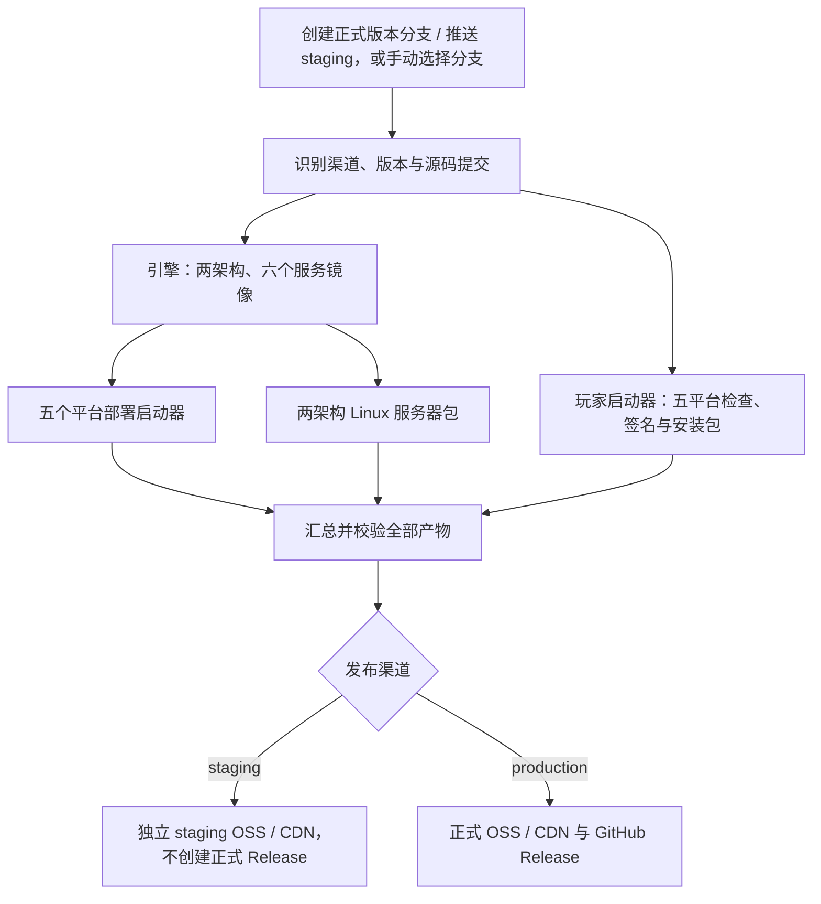

# 发布与版本

`staging` 和正式版本分支共用同一套构建、校验、签名、打包与汇总流程。引擎使用 `release.yml`，玩家启动器使用 `player-launcher-release.yml`；没有单独的测试打包流程。

## 一套流程，两个渠道



两条产品流水线独立完成汇总；上图展示共同阶段。开发阶段的 Verify 只检查格式、语法和代码风格，不打包；合入 `main`、`staging` 或 `release/v…` 的 PR 直接跳过 Verify，避免重复检查。正式发布通过创建版本分支触发：引擎用 `release/v<版本>`，玩家启动器用 `player-release/v<版本>`，成功后由维护者同步 `main`。创建分支即可构建，无需先向固定 `release` 分支合并 PR；后续推送和手动运行也支持同一入口。

创建事件由 `release-branch-created.yml` 识别分支，仅调用对应产品的发布流水线：`release/v…` 不启动玩家发布，`player-release/v…` 不启动引擎发布。此入口只负责路由，不另建打包流程；需先将工作流更新同步到默认分支，再从包含更新的提交创建版本分支。分支名不能含空格或不可见字符。

## 本地开发包

本机执行 `package:images`、`export:images`、`package:desktop`、`package:web`、`package:player-launcher`（含平台后缀）统一生成 `dev` 包，与当前检出的分支无关。引擎版本为 `2026.1.4-dev`，玩家版本为 `2026.1.2-dev`，镜像标签如 `v2026.1.4-dev-linux-arm64`；源码中的发布版本保持不变。

开发部署包内置 dev 镜像，使用独立应用标识、数据目录和桌面容器项目，不检查线上更新；更新时重新打包。已有正式或 staging 镜像归档不能作为 dev 包输入，需先重新执行 `package:images`。`--mode local` 继续表示复用本机已构建的 dev 镜像。

只有 GitHub Actions 的发布流程使用 `staging` / 正式渠道；本机设置同名渠道变量也仍生成 dev 包。

## 版本与文件名

| 内容       | 正式示例                                          | 预发布示例                                                |
| ---------- | ------------------------------------------------- | --------------------------------------------------------- |
| 引擎版本   | `2026.1.4`                                        | `2026.1.4-staging`                                        |
| 部署启动器 | `BOX-Local-Engine-2026.1.4-macos-arm64.zip`       | `BOX-Local-Engine-2026.1.4-staging-macos-arm64.zip`       |
| Linux 包   | `BOX3-Engine-Server-2026.1.4-linux-arm64.zip`     | `BOX3-Engine-Server-2026.1.4-staging-linux-arm64.zip`     |
| 镜像标签   | `v2026.1.4-linux-arm64`                           | `v2026.1.4-staging-linux-arm64`                           |
| 玩家版本   | `2026.1.2`                                        | `2026.1.2-staging`                                        |
| 玩家安装包 | `BOX3-Player-Launcher-2026.1.2-windows-amd64.exe` | `BOX3-Player-Launcher-2026.1.2-staging-windows-amd64.exe` |

预发布后缀属于实际应用版本，不只是 ZIP 名称。流水线在临时构建工作区准备版本，无需把源码版本手工改成 staging，也不创建 staging Git Tag。正式 Tag 仍由流水线固定为 `v<引擎版本>` / `player-v<玩家版本>`。

正式版本取分支名，采用 `YYYY.N.P`：`release/v2026.1.5` 生成引擎与部署启动器 `2026.1.5`，`player-release/v2026.1.3` 生成玩家启动器 `2026.1.3`。流水线自动准备实际构建版本，无需先手改全部版本文件。源码 `package.json` 继续提供本地 dev 和 staging 的基础版本。一个正式版本只能对应一个提交。

## OSS 与更新隔离

| 内容               | 正式目录                                   | 预发布目录                                                     |
| ------------------ | ------------------------------------------ | -------------------------------------------------------------- |
| 引擎镜像和构建产物 | `local-engine/v<版本>/`                    | `local-engine-staging/v<版本>-staging/<commit>/`               |
| 部署启动器         | 上述目录的 `desktop-lightweight-<commit>/` | 同样的子目录规则                                               |
| 引擎分发与 latest  | `local-engine/`                            | `local-engine-staging/`                                        |
| 玩家安装包         | `box-player-launcher/player-v<版本>/`      | `box-player-launcher-staging/player-v<版本>-staging/<commit>/` |

预发布镜像清单固定到源码提交，安装包使用 staging 镜像和更新地址，不回退到正式目录。预发布桌面程序使用独立应用标识、数据目录和容器项目；在独立测试环境运行，业务端口配置与正式环境一致。

同一提交重跑可复用缓存；新的 staging 提交使用新目录，不会借用旧提交镜像。手动运行引擎工作流并勾选 `rebuild_images` 可强制重建该 staging 提交的镜像和部署启动器。更新提示按版本比较，同基础版本的新 staging 包可手动下载安装。

## 维护者操作

| 步骤     | 操作                                                                     |
| -------- | ------------------------------------------------------------------------ |
| 准备     | 提交待发布代码和对应版本的更新日志，完成基础检查                         |
| 模拟发布 | 推送 `staging`，查看两条工作流的全部目标与汇总任务                       |
| 业务验收 | 下载 staging 包，检查安装、登录、地图、备份与更新；核对版本、架构和提交  |
| 正式发布 | 创建 `release/v<引擎版本>` 或 `player-release/v<玩家版本>`，检查对应产物 |
| 升级     | 同步 `main`；保留 `.env`、作品和数据库备份，再部署                       |

流水线检查本次源码中的内部文件、凭据和运行数据。Git 全历史审计按[检查与测试](testing.md)单独执行；发布检查通过不代表历史记录已经清理。

正式发布示例，仓库根目录执行。先为引擎目标版本补充 `distribution/release-notes.json`；缺少对应日志会在构建前报错：

```sh
# 从已验收的提交创建分支；两个产品按需单独发布
git switch -c release/v2026.1.5
git push -u origin release/v2026.1.5

# 玩家启动器从同一个已验收提交创建自己的版本分支
git switch -c player-release/v2026.1.3
git push -u origin player-release/v2026.1.3
```

正式失败后，同一提交可重跑；版本保留后需要修改源码或签名时，创建新版本分支，不移动旧 Tag。首次推送新分支由创建事件路由到对应产品的手动入口，重复的 push 构建任务跳过，避免重复打包。回滚前确认旧镜像与数据格式兼容。

## 配置入口

在 Actions Secrets 配置 `ALIYUN_OSS_BUCKET`、`ALIYUN_OSS_ENDPOINT`、`ALIYUN_OSS_ACCESS_KEY_ID` 和 `ALIYUN_OSS_ACCESS_KEY_SECRET`。Bucket 仅填名称，Endpoint 不带协议或路径。CDN 需能读取新增的两个 staging 目录。

| 流水线               | 配置                                                                            |
| -------------------- | ------------------------------------------------------------------------------- |
| 引擎预发布与正式发布 | [release.yml](../.github/workflows/release.yml)                                 |
| 玩家预发布与正式发布 | [player-launcher-release.yml](../.github/workflows/player-launcher-release.yml) |
| 基础检查             | [verify.yml](../.github/workflows/verify.yml)                                   |
| 正式 Linux 包补打    | [package-server.yml](../.github/workflows/package-server.yml)，复用正式应用镜像 |

玩家签名与平台验收见[玩家发布说明](../apps/player-launcher/docs/release.md)，详细手动测试见[检查与测试](testing.md)。
