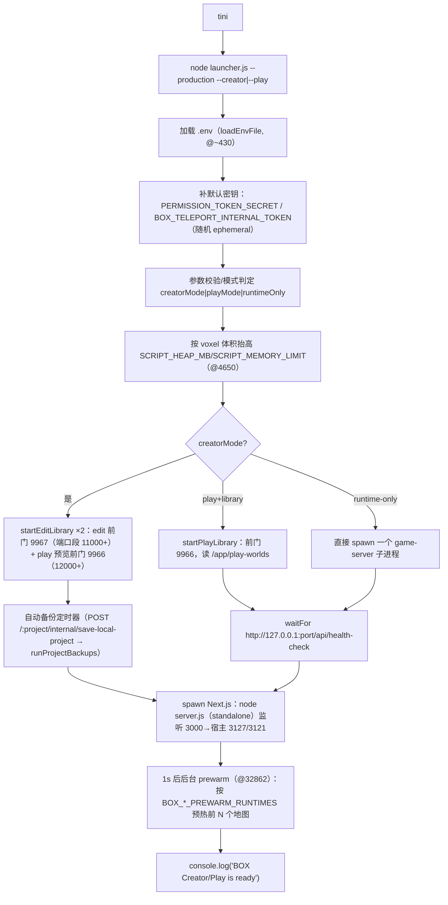
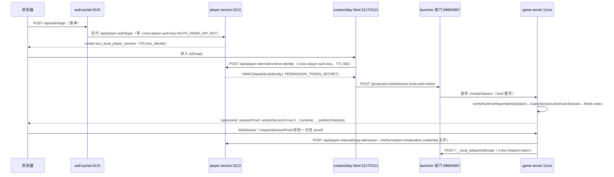
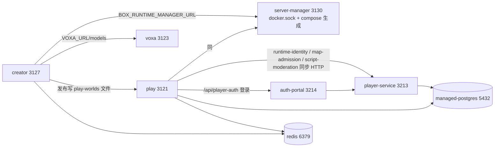

# C. BOX3 Local Engine —— 架构与进程模型复原（基于出厂代码取证）

取证时间：2026-10-17。取证方式：`docker create` + `docker cp` 将 6 个 v0.3.0 镜像的 `/app` 抽取到 WSL 侧只读副本，逐文件阅读；未触碰任何运行中的 `box-local-engine-*-1` 容器，未写入 `~/box3`。

**取证目录说明（重要，供其他 lane 复现）**：任务指定的 `/tmp/re-arch` 在 18:17 左右因 WSL 被外部重启而清空（`uptime` 显示 7 分钟，`/tmp` 为 ext4 根上的普通目录，重启即失），因此我把抽取物迁到持久路径 `/var/tmp/re-arch`，并把 `/tmp/re-arch` 做成指向它的符号链接。本文所有相对路径均以容器内 `/app` 为根，映射关系：

| 容器内路径 | 本地取证路径 |
|---|---|
| `/app/apps/local-engine/**` | `/var/tmp/re-arch/creator-local-engine/**`、`/var/tmp/re-arch/play-local-engine/**` |
| `/app/services/game-server/**` | `/var/tmp/re-arch/creator-services/game-server/**` |
| `/app/apps/game/.next/**` | `/var/tmp/re-arch/creator-next/**` |
| `/app/internals/**` | `/var/tmp/re-arch/creator-internals/**` |
| player-service / voxa / auth-portal / server-manager | `/var/tmp/re-arch/{auth-portal,server-manager,manifests}/**`（voxa、player-service 仅抽了路由清单到 `manifests/`） |
| v0.3.0 由 manager 生成的运行时 compose | `/var/tmp/re-arch/runtime-compose.yml`（从 `server-manager-1:/workspace/.runtime-compose.yml` 拷出） |

**引用约定**：出厂 JS 均为 swc/webpack 产物，标识符完整、空白被剥离，绝大多数文件逻辑上只有 1 行。因此 `路径:1@<字节>` 中的 `@<字节>` 是 `grep -oab` 测得的字节偏移，用于在同一行内定位；真实多行文件（`apps/game/.next/standalone/apps/game/server.js`、各 `*.json` 清单、`*.dts`）直接给真实行号。凡无法定位偏移的论断，同时给出可 grep 的锚点字符串。

**可重建性判定**：全镜像 `find -name '*.map' -not -path '*/.pnpm/*' | wc -l` = **0**，无 sourcemap。但后端（launcher + game-server + @box 私有包）是未混淆的 CommonJS，标识符、日志文案、错误消息全为原文，可 1:1 读懂；`services/game-server/node_modules/@box/*` 私有包随镜像完整分发（mudb 864K、schema 1.7M、build-system 1.3M、script-api 96K、content-server 132K、voxa-project 840K、vb-parser 700K、apis 180K、utils 388K、env 104K，实测 `du -sh`），等于把内部框架源码一起交出来了。**唯一不可完全重建的是浏览器端 React UI**：`apps/game/.next/server/chunks` 里的页面逻辑可读，但客户端 chunk 经 webpack 压缩且无源码，不过所有 API 契约（路由名、请求体字段、错误中文文案）都在服务端产物里，足以重写后端。

---

## 1. 出厂仓库/模块布局：一个 monorepo，6 个 target

单仓库 `rush/pnpm` 布局（`launch.js --help` 文案仍写 `rushx build:creator`，`services/game-server/dist/src/launch.js:1@0` 之后；`launcher.js:1@~25000` 抛错文本 "Run `rushx build:play` from apps/local-engine"），出厂时按 Dockerfile target 裁剪成 6 个镜像：

```
/app
├── LICENSE                                   (MIT，6 镜像相同)
├── apps/
│   ├── local-engine/
│   │   ├── src/           18 个 js（launcher/project-manager/edit-library/…）
│   │   ├── config/local.config.json
│   │   ├── data/blobs/    出厂内置内容（runtime-blobs.json 18K，formatVersion:1 + base64url 哈希数组）
│   │   ├── projects/      空（宿主 bind mount 覆盖）
│   │   └── dist/          空（宿主 bind mount 覆盖）
│   └── game/.next/standalone/   Next 15.5.24 独立构建（apps/game + packages/* + internals/* 全量文件追踪）
├── services/game-server/
│   ├── dist/src/**        1.74 MB 游戏服务端
│   └── node_modules/      125 MB（pnpm 仓库实体，含 typescript@5.6.3 19M、ffmpeg-audio 4.4M、isolated-vm 1.8M 连 C++ 源码与 binding.gyp、sharp 804K、redis-mock、request/uglify-js/get-pixels 等）
├── internals/deployment-routing/  10 个 .cjs（12 KB，Next 基路径/代理补丁）
└── distribution/          LICENSE.txt + play/.env.example
```

**是否同一个 bundle 复用？是的。** 实测（`md5sum`、`diff -rq`）：

- `apps/local-engine/src/launcher.js` 在 creator 与 play 镜像中 **md5 完全相同** = `ea7f9cd341d17044ad772133e0fa5d6b`。
- `services/game-server/dist` 两镜像唯一差异是 `Only in creator/services/game-server/dist/src: edit`，即 **构建期剪掉了 `edit/`（139 KB 协同编辑模块）**，其余逐文件相同。
- `apps/local-engine/src` 清单差异（`diff <(ls creator…) <(ls play…)`）：play 缺 `project-manager.js`(88K)、`edit-library.js`(12K)、`asset-distribution.js`、`distribution-metadata.js`、`map-group-manager.js`，多一个 `play-library.js`。launcher 之所以能不带 project-manager 启动，是因为它把 require 写成条件懒加载：`launcher.js:1@3230` `const projectManager=!playMode||projectId||releaseId?require("./project-manager"):null`。
- 顶层差异：play 无 `distribution/`，多 `play-runtime-cache/`（`compose.yml` 里的 named volume `box-play-runtime-cache`，见 `runtime-compose.yml:407/500`）。
- 体积实测（`du -sh` 抽取结果）：creator 398M、play 359M、voxa 196M、player-service 246M、auth-portal 280K、server-manager 4.1M。

各镜像内容物差异（决定"哪个进程装了什么"）：

| 镜像 | `/app` 组成 | 入口（`docker inspect` 实测） |
|---|---|---|
| creator | 全量：local-engine + game(.next) + game-server + internals + distribution | `tini -- node apps/local-engine/src/launcher.js --production --creator` |
| play | 同上但无 distribution、无 project-manager/edit 模块 | `… launcher.js --production --play` |
| voxa | 仅 `apps/voxa/.next/standalone` + internals + `apps/voxa/data` | `tini -- node apps/voxa/.next/standalone/apps/voxa/server.js` |
| player-service | **仅 `apps/game/.next/standalone` + internals**（246M，无 local-engine、无 game-server） | `tini -- node apps/game/.next/standalone/apps/game/server.js` |
| player-auth-portal | `build/server.cjs`(226K) + `public/{index.html,app.js,styles.css,theme.js}` | `docker-entrypoint.sh` + `node build/server.cjs`（唯一 tini-less、非 monorepo 的服务） |
| server-manager | `/app/server-manager` 3.97 MB  stripped ELF + `/app/public`（React 管理台 SPA） | `/app/server-manager`（无 entrypoint），Rust |

关键含义：**player-service 与 creator/play 跑的是同一个 Next 应用的同一份构建产物**，只靠 `BOX_DEPLOYMENT_MODE` 环境变量在路由内部再分叉（`pages/api/player-internal/runtime-identity.js` 编译体：`if("player-service"!==process.env.BOX_DEPLOYMENT_MODE)return b.status(404).end()`），三个镜像里 105/97/49 条路由（`/api/*` 分别 93/86/44 条，python3 精确计数）互为子集。这就是"一栈多态"的根因，也是第 10 节批判第 1 条的证据来源。

---

## 2. `launcher.js` 控制流

文件：`apps/local-engine/src/launcher.js`（34 KB / 逻辑 1 行 / 3 物理行）。它是"进程编排器 + 反向代理 + 定时器"三合一的单文件脚本，无框架。



逐步取证：

1. **启动即生成密钥**：`launcher.js:1@~430` 起 `if(!process.env.PERMISSION_TOKEN_SECRET){…crypto.randomBytes(32)…console.warn("PERMISSION_TOKEN_SECRET is unset; generated an ephemeral launcher secret.")}`，紧接 `BOX_TELEPORT_INTERNAL_TOKEN` 同样处理。二者只在这一个进程里生成，通过 `sharedEnv` 传给所有子进程。
2. **参数面**：`launchFlags = {--production,--creator,--play,--runtime-only}`、`launchValueFlags = {--project,--release,--runtime-mode}`，未知参数直接 throw；三种模式互斥（"Choose only one launch mode"）。`--production` 影响：入口改为 `dist/src/launch.js --useProdBundle`（否则 `-r @swc-node/register src/launch.ts`）、资源路径改为 `services/game-server/dist/src/assets/block_info.js`、并强制校验 `.next/BUILD_ID` / `BOX_PLAY_BUILD` / `dist/src/launch.js` 存在。
3. **`BOX_DEPLOYMENT_MODE` 只在最后一跳被设置**：`launcher.js:1@32345` `BOX_DEPLOYMENT_MODE:playMode?"play":"creator"` —— **launcher 自己按 CLI flag 分支，Next.js 进程按这个环境变量分支**；player-service 容器不走 launcher，由 compose 直接注入 `BOX_DEPLOYMENT_MODE: player-service`（`runtime-compose.yml:54` profile + env 段）。
4. **无 DB/Redis 连接**：launcher 完全不碰 Postgres/Redis（全文无 `pg`/`redis` require）。数据库连接发生在 game-server（`entry.js:1@~` `createRuntimeRedisStore` ×2、`storage/postgres-data-storage.js`）和 Next 侧的身份模块（`chunks/980.js`）。Redis/PG 缺失时都是"降级"而非"失败"（见第 6 节）。
5. **两个前门 HTTP 服务器**：creator 模式下同时 `startEditLibrary` 两次（`launcher.js:1@27902` `runtimePortStart:11e3`，`@28500` 段 `runtimePortStart:12e3`），分别绑 `BOX_EDIT_RUNTIME_PORT`(默认 9967) 与 `BOX_PLAY_RUNTIME_PORT`(默认 9966)，`await Promise.all([editLibrary.ready, creatorPlayLibrary.ready])`。宿主 compose 把 9966/9967 以 `127.0.0.1:` 前缀发布（host `compose.yml:343-344`）。
6. **spawn 三种运行时**：
   - `startGameServer(mode,port)`（进程内直启，`--runtime-only` 与单地图部署用）；
   - `startProjectRuntime()` → **递归 spawn 自己**：`spawn(process.execPath,[…,"src/launcher.js","--production","--runtime-only","--runtime-mode",mode,"--project",project.id],{detached:true})`；
   - `startLibraryRuntime()` → 直接 spawn game-server。
   三者都经 `spawnRuntime()`，它在 cwd==game-server 时先注入"审核凭证"临时文件（`launcher.js:1@346` 附近 `createModerationCredential(options.env, process.env.BOX_MODERATION_SIGNING_SECRET||"")`）。
7. **调度器优先**：每个 spawn 前都先 `startScheduledContainer()`（`launcher.js:1@7951`），若该地图 profile 的 `isolation==="container"` 且 `BOX_RUNTIME_MANAGER_URL/TOKEN` 齐备，则改由 Rust manager 建容器，返回 `{hostname,port,containerId}`；否则打印"using the shared Node runtime"并走进程模式。注意其中硬编码 `teleportControlUrl:"http://play:9966/__local_teleport"`（compose 服务名字面量写在 JS 里）。
8. **就绪与超时**：`waitFor(url,{timeoutMs:BOX_RUNTIME_START_TIMEOUT_MS||1800000})`（30 分钟）逐 500ms 轮询 `/api/health-check`；`runtime-readiness.js:1` 的 `waitForRuntimeReady` 在窗口内每 250ms 采样 `/proc` 计算进度百分比回调。
9. **进程树度量**：`attachRuntimeMetrics` 用 `/proc/<pid>/status`+`/stat` 递归求和 CPU ticks 与 VmRSS（`runtimeProcessStats`/`readRuntimeProcessTree`），250ms 缓存 —— 管理台的每图 CPU/内存就是这里来的。
10. **退出路径**：`shutdown()` SIGTERM 所有 child + `library.stop()` + `clearInterval`，200ms 后 `process.exit`；`terminateRuntimeChild` 先对整个 process group 发 SIGTERM（`process.kill(-child.pid)`），1.5s/5s 后 SIGKILL。
11. **prewarm**：`launcher.js:1@32862` 的 `setTimeout(...,1e3)`，creator 预热 `BOX_CREATOR_EDIT_PREWARM_RUNTIMES`（默认 **0**）个项目，play 预热 `BOX_PLAY_PREWARM_RUNTIMES`（默认 **0**），上限被 `prewarmCount` 夹到 `*_MAX_RUNTIMES`。也就是说**出厂默认不预热**，第一张图冷启动完全暴露在用户面前（`MAX_ZERO_PLAYER_TIME` 默认 `2147483647`，即不零人回收，见 `startGameServer` env）。

---

## 3. 路由总表

`box.routing.base-path=runtime-v1` 的含义（实测结论）：**6 个容器都带这个 label，但抽到的 JS 与 Rust 二进制里没有任何代码读取该 label**（`strings -n 4 server-manager | grep -o '.\{0,40\}runtime-v1.\{0,40\}'` 无输出；全 JS grep 只命中 `box3-moderation-runtime-v1:` 这一 HMAC 前缀，`@box/utils/build/moderation-runtime-auth.js:12`）。真正生效的是 **`BOX_APP_BASE_PATH`**（`runtime-compose.yml:76/150/260/443/528` 每个 Web 服务各一个），配套 `internals/deployment-routing/*` 做 HTML 前缀改写；label 更像是给**宿主侧统一网关**声明"这套服务的路由契约版本 = runtime-v1"的静态元数据。

### 3.1 Creator 编辑 API（Next `apps/game` 进程，宿主 3127）
路由清单来自 `apps/game/.next/server/pages-manifest.json`（**105 条**，实测 `node -e Object.keys().length`）。鉴权：浏览器侧 cookie `box-local-session`（`config/local.config.json` `AUTH_COOKIE_NAME`）+ `PERMISSION_TOKEN_SECRET` 签名的 runtime identity；机器侧 `x-box-player-auth-key`。

| 方法/路径 | 用途 | 鉴权 |
|---|---|---|
| `GET /api/creator/v1/health` | 健康 | 无 |
| `GET/POST /api/creator/v1/projects`、`/api/creator/v1/projects/:id/{resources,runtime,runtime/events,scene/session,scene/action,scene/actions/:requestId,scene/capture,scripts,scripts/:side/:entry,storage/:scope/:space}` | **对外 Creator OpenAPI v1**（项目、运行时、场景动作、脚本、存储） | 需 creator 身份/CLI 权限（identity 里 `creatorAccess`、`creatorPermissions`、`creatorCliPermissions` 三字段，`@box/utils/local-player-identity.js:1@` `validIdentity`） |
| `/api/local-projects[...]`（12 条：CRUD、`/:id/{export,maps,package,publish,snapshots}`、`import`、`asset-distribution`） | 本地工程与发布管理，直接 `createRequire` 载入 `local-engine/src/project-manager.js` | 本地登录态 |
| `/api/creator-models[...]`（5 条） + `/api/creator-permissions` + `/api/creator-profile` + `/api/creator-logout` | 模型/皮肤资源库与权限档 | 本地登录态 |
| `/api/play-admin/*`（27 条：login/verify/logout/owner-session/admins/players/identity-bans/worlds/containers/container-resource-groups/script-moderation/library/import/maintenance/status/activity/self-password/permission-groups） | 游玩侧管理台（**与 player-service 同一份代码**） | `BOX_PLAY_ADMIN_TOKEN` + cookie `box_local_admin_session`/CSRF `box_local_admin_csrf`（`chunks/3377.js`） |
| `/api/player-auth/*`(7)、`/api/player-internal/*`(8)、`/api/player-launcher/*`(4) | 玩家身份/内部接口/启动器目录 | `player-internal` 需 `x-box-player-auth-key`（见 3.4） |
| `/api/createSession`、`/api/realtime/session`、`/api/getMapInfo`、`/api/config/[...slug]`、`/api/health-check` | 会话、实时、地图信息、配置代理 | 会话 |
| `/api/system/backups[/..]`、`/api/system/status` | 备份与磁盘状态（`chunks/5777.js` 里 `disk:{state,totalBytes,freeBytes}`） | 登录态 |
| 页面：`/`、`/projects`、`/projects/launch`、`/play-launch`、`/play-system`、`/p/[gameName]`、`/login-required`、`/creator-access-required`；App Router 仅 `/e/[container]`（`app-paths-manifest.json:2`） | UI | — |

### 3.2 Play 运行时 API
两层。

**前门（launcher 进程 9966/9967，`edit-library.js:1@1791`+`@10781`）**：URL 形如 `/{project}[/__room/{roomId}]/...`，首段被 `parseProjectRequest` 吃掉后转发给子运行时。
- `GET  /:project/__local_runtime/status` → 阶段/百分比/端口/pid/在线数/CPU/RSS + `rooms`
- `POST /:project/__local_runtime/start`（头 `x-box-runtime-restart:1` 可复活）→ 202 异步预热
- `POST /:project/__local_runtime/destroy` → 204
- `POST /:project/__local_teleport/allocate`、`/authorize` → 需头 `x-box-teleport-token`（`teleport-room-manager.js:1@2470`，`timingSafeEqual`）
- 其余路径全部透传给子运行时；`upgrade` 事件走裸 TCP 拼接重写过的 HTTP 头（`edit-library.js:1@10781`）。

**游戏运行时（`services/game-server`，`entry.js` 注册 `httpRoutes` 后由 `createServer.js` 追加）**：

| 路径 | 注册点 | 用途 | 鉴权 |
|---|---|---|---|
| `GET /api/health-check` | `entry.js:1@10663` | 返回 `runtime/redis{business,cache}/storage` 状态 | 无（launcher 就绪探测） |
| `GET/HEAD /block/:hash[/raw]` | `entry.js:1@11880` `createContentRouter`，带 `allowedOrigins`/`deniedHashes`/`readOnly:mode==='play'` | **IPFS 风格内容寻址 blob 分发**（美术、模型、音频、脚本 chunk） | Origin 白名单 |
| `POST /createSession` | `createServer.js:1@~13000` | 换 sessionId + `sessionProof` + `socketServerUrl` + `prefetchHashes` | 非 local 时 `Authorization: BACKEND_AUTH_CODE`；local 时 identity token |
| `POST /api/session`、`GET /api/server-info` | `createServer.js` 尾部 `if(mode==='play'&&directSessionApi)` | 公网直连版会话 API；**launcher 设 `BOX_DIRECT_SESSION_API:"false"` 关掉**，所以出厂实例只走 `/createSession` | `direct=true` 时放开 CORS |
| `GET /api/project-skin-previews` | `entry.js` | 皮肤预览表 | local only |
| `GET/POST /internal/creator-preview-runtime[/events]` | `createServer.js:1@~14000` | 预览运行时起停 + SSE 进度 | **仅 127.0.0.1**（`localOnly` 显式判 socket.remoteAddress） |
| `POST /internal/save-local-project` | `createServer.js:1@14830` | 落盘工程（`editServer.replica.saveProject()`），也是自动备份入口 | 仅回环 |
| `POST/GET /api/project-models`、`/api/project-scripts`、`/api/project-skins` | `createServer.js:1@2614` 起 | 模型/皮肤从 VOXA 导入（`storeVoxaBlob` 拉 `/api/local/blobs/:hash/raw` 并校验哈希）、共享脚本 | 回环 + edit 模式 |

WS：`MuWebSocketServer({server:httpServer,requireSessionProof:true,maxPayload: edit?16MB:1MB})`（`createServer.js:1@3738`）。浏览器拿到的 `socketServerUrl` 由 Next 侧改写为 `ws://<web host>/runtime/{edit|play}[/:path]`（`pages/api/createSession.js` 编译体内 `"creator"===mode` 分支），再由 Next 的 rewrites 打到 9967/9966（`apps/game/.next/standalone/apps/game/server.js:12`，`@7162`），前门再代理到 11000+/12000+ 子进程。**没有 socket.io，是 @box/mudb 自研二进制 diff 协议**（MuStruct/MuWriteStream，rda/replica/rpc）。

### 3.3 Server-manager 控制 API（Rust，3130）
由 `strings` 复原（`/var/tmp/re-arch/server-manager/server-manager`）：
```
GET    /api/health                        （--healthcheck 自探）
POST   /api/runtime/ensure               ← runtime-container-client.js:1@603 postApiRuntimeEnsure
DELETE /api/runtime/{container_id}
GET    /api/runtime/{container_id}/stats
POST   /api/backups/upload
GET    /api/backups/{archive}/download
GET    /api/diagnostics/{archive}/download
POST   /api/commands/{name}
GET    /api/operations/{id}
GET    /api/events                        （SSE 进度流）
```
鉴权头 `x-box-runtime-token`（同串出现在 `runtime-container-client.js:1@~200`）。Rust 源路径残留：`/source/apps/manager-core/src/{auth_portal,backup,configuration,configuration_migration,public_access,services}.rs`、`/source/apps/manager-core/src/ssl/{apply,local,plan,runtime}.rs`（含 SSL 申请/本地 CA 逻辑）。它同时是 `.runtime-compose.yml` 的生成者（`config_files:/workspace/.runtime-compose.yml`，`BOX_IMAGE_TAG`/`BOX_*_MEMORY_LIMIT`/`BOX_*_CPU_LIMIT` 等一整套 env 名可在二进制 strings 中枚举）。

### 3.4 VOXA API（3123→3001）
`manifests/voxa/pages-manifest.json`，共 **14 条（其中 9 条 `/api/*`）**：`/api/health-check`、`/api/local/blob`、`/api/local/blobs/[hash]`、`/api/local/default-skin`、`/api/local/models`、`/api/local/models/[id]`、`/api/local/models/[id]/export`、`/api/local/models/[id]/snapshots`、`/api/local/models/import`（+ 3 个 UI 壳）。game-server 侧调用统一带 `voxaInternalHeaders()`（`createServer.js:1@2614`）。

### 3.5 身份 API（player-service 3124→3213）
`manifests/psvc/pages-manifest.json` **49 条（44 条 `/api/*`）** = `player-auth/*`(7, 面向浏览器的注册/登录/改密/会话) + `player-internal/*`(8: `runtime-identity`、`map-admission`、`map-library`、`profile`、`revocations`、`logout`、`script-metadata`、`script-moderation`) + `play-admin/*`(21, 只保留数据面，无 worlds/status/maintenance 之类) + `/api/realtime/session` + `/api/config/[...slug]` + `/api/health-check`。
`player-internal` 的门禁在 `chunks/980.js:1@3118`：header `x-box-player-auth-key`，与 `BOX_PLAYER_AUTH_API_KEY` 做 sha256 双摘要 `timingSafeEqual`；密钥长度 <16 直接 503 `AUTH_API_KEY_NOT_CONFIGURED`，并先校验 `BOX_DEPLOYMENT_MODE==='player-service'` 否则 404。

### 3.6 Auth Portal（3125→3214）
`auth-portal/build/server.cjs`（226 KB 单文件）仅 7 条：`/api/auth/{login,logout,password,profile,register,session}`、`/api/health-check`。它只读 `AUTH_DEMO_{HOST,PORT,PLAYER_SERVICE_URL,PUBLIC_URL,CREATOR_URL,PLAY_URL,API_KEY,REGISTRATION_ENABLED,REQUEST_TIMEOUT_MS,TRUST_PROXY}` 与 `BOX_APP_BASE_PATH`/`BOX_PUBLIC_SERVICE_PREFIXES`，是个**纯反代 + 静态登录页**，自身不落任何状态。

---

## 4. 运行时模型：一张地图如何变成一个游戏进程

```
浏览器 → Next(3127/3121) ──/runtime/edit|play/*──► launcher 前门(9967/9966)
                                                      │ parseProjectRequest(/{project}[/__room/{room}])
                                                      ├─ status/start/destroy 内部路由
                                                      ├─ teleport allocate/authorize
                                                      └─ http.request/net.connect 代理 ──► 子运行时 11000+ / 12000+
                                                                                            (node dist/src/launch.js)
                                                                                              └─ fork ivmp-process-entry（isolated-vm）
```

1. **身份解析**：`edit-library.js` 的 `resolveProject`（由 launcher 注入，走 `projectManager.getProject` / `listProjects` 的 publicId/permanentMapId 兜底）返回 `{id,permanentMapId,publicId,mapGroupId,mainProjectId}`；地图永久 ID 是 **20 位 hex**（`map-identity.js:1` `mapIdentityPattern=/^[0-9a-f]{20}$/`，`createMapIdentity()`=10 随机字节）。
2. **profile 决策**：`map-runtime-profiles.js:1` 的 `resolveMapRuntimeProfile`：`mode!=="play"` 一律 `isolation:"process"`（**编辑态永远不隔离**）；play 态查 `BOX_MAP_RUNTIME_PROFILES_PATH`（出厂 compose 指 `/app/apps/local-engine/data/map-runtime-profiles.json`）里的 `profiles[]`+`resourceGroups[]`，只有资源组给了 cpuMilli/memoryMb 才变 `isolation:"container"`。默认无 profile ⇒ 进程隔离，`BOX_LOCAL_PLAYER_LIMIT`(70)/`BOX_TELEPORT_MAX_ROOMS`(64)/`BOX_RUNTIME_IDLE_TIMEOUT_MS`(900000) 作为默认。
3. **进程隔离路径**：`startProjectRuntime` 递归 spawn 自己（`--runtime-only --runtime-mode play --project id`），子 launcher 只起 game-server 一个子进程。实测（`docker top`）空载 creator 容器 = tini + launcher + `node server.js`；一旦有 N 张图在跑，就是 **每图 3 个进程**：递归 launcher 监督进程 + game-server + ivmp 脚本进程（外加 isolated-vm 线程、pino thread-stream、sharp/libvips）。端口从 11000(edit)/12000(preview) 起 `allocateRuntimePort` 逐个 `net.createServer` 试探（`edit-library.js:1@1791`，最多 512 次）。
4. **容器隔离路径**：`ensureRuntimeContainer`（`runtime-container-client.js:1@603`）POST `/api/runtime/ensure` 带 `{permanentMapId,mode,roomId,projectId,cpuMilli,memoryMb,processLimit,networkPolicy,bandwidthMbps,playerLimit,idleTimeoutMs,teleportControlUrl,teleportInternalToken,port}`，返回 `{hostname,port,containerId}`；`metrics()` 打 `/api/runtime/{id}/stats`，`stop()` 打 DELETE。二进制里存在的镜像名前缀是 `box-local-engine-runtime` 与容器名前缀 `box-runtime-`，但**本机已安装镜像中没有 runtime 镜像**（`docker images` 实测 6 个）→ 出厂态下容器隔离实际不可用，只能吃"shared Node runtime"降级分支。
5. **就绪/预热/回收**：`runtime-readiness.js` 把 health-check 轮询包装成 42%→90% 进度；`runtime-lifecycle.js:1` 的 `ensureCapacity` 在 `runtimes+starts` 达到 `BOX_CREATOR_EDIT_MAX_RUNTIMES`(6)/`BOX_PLAY_MAX_RUNTIMES`(8)/`BOX_CREATOR_PLAY_MAX_RUNTIMES`(4) 时，按 `lastAccessAt` 最旧且 `activeConnections===0` 的运行时淘汰，找不到就 503；`collectIdle` 由前门 `setInterval` 每 `clamp(idleAfter/2,5s,60s)` 触发一次，同时跑 `teleportRooms.collectIdle()`。`acquire()` 用引用计数（连接级 touch），`/internal/save-local-project` 的自动备份请求特意 `touchAccess:false`，**保存工程不会给运行时续命**（`edit-library.js` 中 `lifecycle.acquire(runtime,{touchAccess:forwardedPath!=="/internal/save-local-project"})`）。
6. **零人回收**：game-server 自己也有 `MAX_ZERO_PLAYER_TIME`（`startGameServer` env；launcher 未传时用 `ServerSettingsSchema` 默认，实际 launcher 写的是 `2147483647`＝不回收），而 `startLibraryRuntime` 用的是 profile 的 `idleTimeoutMs`。两套语义并存。
7. **传送/房间分片**：`teleport-room-manager.js:1` 的 `createTeleportRoomManager` —— `world.teleport()` 脚本调用打到源运行时的 `/__local_teleport/allocate`（脚本 → 本进程 → 前门），要求 source/target **同一 `permanentMapGroupId`**（`MAP_GROUP_MISMATCH` 403），一次最多 50 个 subject，生成 32 字节 base64url 房间 ID（`roomIdPattern=/^[A-Za-z0-9_-]{16,128}$/`），`ensureRuntime(target, roomId)` 拉起一个私有房间实例（`TYPE=teleport`，`SERVER_ID=roomId`），返回 `{playHash,serverId}` 给客户端重连；玩家随后走 `authorize`（校验 subjectId 在 room.subjects 内）。房间上限 `BOX_TELEPORT_MAX_ROOMS`(64，硬顶 1024)，空闲 `BOX_TELEPORT_ROOM_IDLE_TIMEOUT_MS`(900000)。所以"分片"= **每房间一个完整 Node 进程**，不是同进程内的逻辑房间。
8. **组状态锁**：`creator-services/game-server/dist/src/project/local-project-state.js:1@6596` 的 `withGroupStateLock(statePath, op)`：`openSync(lockPath,"wx")` 抢 `project-state.json.lock`，抢不到就 **`Atomics.wait(new Int32Array(new SharedArrayBuffer(4)),0,0,20)` 在主线程上 20ms 睡眠自旋**，直到 `BOX_GROUP_STATE_LOCK_TIMEOUT_MS`(30s) 超时；另有 `.shared-resource.lock` 同机制；陈旧锁靠 `pid/hostname/token` 元数据 + `process.kill(pid,0)` + dev/inode/size/mtime 快照比对来回收（`recoverAbandonedGroupStateLock`）。这是一段**为多进程共享同一 bind mount 目录而写的分布式文件锁**，跑在持锁进程的事件循环里。
9. **审核凭证注入**：任何 cwd=game-server 的 spawn 都会先 `createModerationCredential()`（`moderation-credential.js:1@429`）写一个 `mkdtemp` 临时文件，HMAC 前缀 `box3-moderation-runtime-v1:`，5 分钟有效期、60 秒刷新，子进程只拿 `BOX_MODERATION_CREDENTIAL_PATH`，`BOX_MODERATION_SIGNING_SECRET` 被显式 `delete`（最小暴露）。
10. **发布链**：creator 的 `publishProject`/`publishMapGroup`/`exportPlayBundle`/`copyReleaseWorld`（`project-manager.js` 函数表实测）把工程写成 play 侧的库目录：`play-worlds/<id>/{manifest.json,data/{project-state.json,blobs}}`（`play-library.js:1@645`），前门按 `BOX_PLAY_LIBRARY_PATH=/app/play-worlds` 加载并按 `manifest.signature=[mtimeMs,size,version,permissionHash]` 做缓存失效。

---

## 5. 脚本沙箱（重写论证的核心）

**结论：不是 `vm`、不是 `worker_threads`、不是 `--experimental-*`，而是 `isolated-vm@5.0.4`（V8 isolate，`.node` 原生扩展 `out/isolated_vm.node`），跑在一个专用 fork 子进程里。**

- VM 选择：`launcher.js:1@3375` `const scriptVm=process.env.BOX_SCRIPT_VM||"ivmp"`；`entry.js:1@17514` `switch(spec.vm){case "local": LocalScriptSocketServer; case "ivm2": Ivm2ScriptServer; case "ivmp"/default: IvmpScriptSocketServer}`。`launch.js --help` 还列出 `local, isolate, worker, isolate-snapshot` 四种，出厂只用 `ivmp`。
- **进程边界**：`ivmp-script-socket-server.js:1` `child_process.fork("./ivmp-process-entry",{execArgv:["--no-node-snapshot"],stdio:"inherit",serialization:"advanced",env:{SCRIPT_TIMEOUT,SCRIPT_MEMORY_LIMIT,…}})`，父子之间用 `@box/mudb/socket/child_process`（MuServer + `RemoteScriptProtocol`）传二进制；子进程崩溃后 `launch()` 会自动重新 fork。
- **内存闸**：`ivmp-vm-controller.js:1@1454` `new ivm.Isolate({memoryLimit:this._memoryLimitMb, onCatastrophicError:…→events.crash→stop})`，`_memoryLimitMb` 来自 `ivmp-process-entry.js:1` `Number(process.env.SCRIPT_MEMORY_LIMIT)||1024`，而 launcher 在 spawn 前按地图体抬高：`launcher.js:1@4650` `requiredScriptMemoryMB = voxels>64M?2048: voxels>16M?1024: 512`，再 `Math.max(env值, required)` 同时写入 `SCRIPT_HEAP_MB` 与 `SCRIPT_MEMORY_LIMIT`。**即内存上限是"按地图体积猜出来的"，且与 6 GB 的容器 mem_limit、`BOX_RUNTIME_NODE_MEMORY_MB` 的 `--max-old-space-size` 三层叠加，无任何 cgroup 级校准。**
- **CPU/死循环闸**：所有进入 isolate 的调用都带 `{timeout:scriptTimeout}`（`postMessage.apply(...,{timeout})`），超时即 `_notifyScriptTimeout → events.crash → stop()`；`parse-error.js` 把 ivm 抛错转成脚本行号。游玩端 `onScriptCrash` 会 `chat.systemBroadcast("scriptCrash")` + 3 秒倒计时 + `synchronizeProject` 整服重启（`play-server.js:1`）。
- **编译复用**：`compileScriptSync(entry,{produceCachedData:true,cachedData:this._cachedData})` —— 用 V8 code cache 反复热启动同一 shell。
- **API 注入面**：`jail.setSync("secret", new ivm.ExternalCopy(hostInterface).copyInto({release:true}))`，hostInterface = `{sessionId, ivm, postMessage, notifyReady, close}`（**注意：把 `ivm` 本身也塞进了 jail**，dev 环境还额外 `jail.setSync("ivm", isolatedVm)`）。真正的对象穿越在 `script/script-shell.js`(32 KB) + `script-host.js`(27 KB) + `script/bindings/{api,entity,world,zone,voxel}-{bindings,synchronizer,update}`(21 个文件)，即"句柄 + diff + 选择器"三件套：作者写的是 `world.findAll("player")` 这类 **CSS 风格选择器 DSL**（`bindings/selectors.js:1`：`*`、`#name`、`.tag`、`entity`、`player` 逗号组合，服务端解析成查询）、`dispatcher` 事件/承诺调度（`bindings/dispatcher.js`，带 5 个计数指标）、以及 `QueryList`。
- **作者可见 API**（`@box/script-api/dts/server-api-types.dts`，1020 行 / 37 KB）：13 个 `declare class` = `GameWorld`、`GamePlayer`、`GamePlayerEntity`、`GameEntity`、`GameStorage`、`GameDataStorage`、`GameMotionController`、`GameMotionHandler`、`GameInputEvent`、`GameTickEvent`、`GameVector3`、`GameRaycastResult`、`QueryList`，加 `WorldEventMap`、`AnticheatContext`、`ModerationOptions`/`ModerationBan*`、`TeleportResult`、`GameSelectorString` 等类型；客户端侧另有 14 KB 的 `client-api-types.dts`。数据存储文档明确"存储空间按地图隔离，编辑模式与游玩模式默认隔离"（`server-api-types.dts` 头部注释），对应 `runtime-storage-namespace.js` 的 `resolveMapRuntimeNamespace`/`resolveGroupRuntimeNamespace`。
- **复杂度占比（这是重写论证）**：`du -sb --apparent-size` 实测 `services/game-server/dist/src` 合计 **1,738,950 B**，其中 `assets/isolate/ivm2-script-entry.js` **809,298 B**（打包进沙箱的 shell + 脚本 API + mudb 客户端，占 47%）、`script/` **273,218 B**、`edit/` **138,968 B**（其中 `replica/replica-server.js` 单文件 66 KB）、`anticheat/` **36,057 B**（13 文件：movement-gate/inspector、message-gate、player-tracker、audit…）、`moderation/` **15,277 B**。合计 **≈1.28 MB / 74%** 的代码只服务于"安全地跑不可信玩家脚本 + 边跑边被编辑 + 防作弊 + 内容审核"；剩下 26% 才是 voxel/physics/net/session 等游戏逻辑本身。重写若要瘦身，砍掉 ivmp + edit-replica + anticheat + moderation 四条链，代码量立刻少三分之二（代价见第 10 节）。
- 反RCE-by-design 的口子：`admin/admin-server.js:1@4956` `new Function("game","return ("+message.data+");")`（`serverEval`）与 `scriptEval`、`exitProcess`、`restartContainer`、`banIp` —— 这些是宿主管理员能力，但**判定只用 `connection.sessionData.isAdmin`**，而 play 模式里 `runtimeIdentity.role==='admin'` 即置 `gameAdmin`（`createServer.js:1@8344` 之后）。

---

## 6. 持久化

| 介质 | 内容 | 证据 |
|---|---|---|
| **Postgres（`box_engine` schema）** | 游戏侧 `GameDataStorage`/`GameStorage` 脚本数据。**不是迁移式 schema，而是按命名规则动态建表**：`tables()` = `"<schema>"."<mode>_[group_]${namespace}_${storageName}"`（超 63 字节做 sha256 截断），成对建 `_keys`（`objectId,key,record,isDelete,createdAt,updatedAt,_rperm,_wperm`）与数据表（`objectId,key,value JSONB,version,metadata,_rperm,_wperm`），索引名同样 sha256 截 16；写入用 `pg_advisory_xact_lock(hashtext(base),hashtext(key))` 串行化（`postgres-data-storage.js:1@11704`）；读取是 `keys JOIN data ON d.objectId=k.record WHERE isDelete=false ORDER BY updatedAt DESC LIMIT 1`（**append-only 多版本 KV，无外键**）。另有 `upgradeLegacyTables()` 在启动时对既有列做 `ALTER COLUMN TYPE` 在线纠偏。schema 名默认 `box_engine`（`dist/config/index.js` `databaseSchema:S("BOX_DATABASE_SCHEMA","box_engine")`），且 `entry.js` 里 `if(storageMode==="pg") storageMode="sqlite"` 的**强制降级**（见第 10 节）。 |
| **Postgres（`box_identity` schema）** | 玩家身份源：`chunks/980.js` 与 `chunks/3377.js` 各自 `CREATE TABLE IF NOT EXISTS ${t("…")}` ×11/×6，串名实测含 `identity_bans`、`player_revocations`、`player_map_library`、`local_users_box_id`、`local_users_user_key`、`box_local_player_session`、`box_local_player_device`；索引 `sessions_principal`、`bans_active`、`bans_source`、`revocations_created`。变量 `BOX_IDENTITY_DATABASE_SCHEMA`（`runtime-compose.yml:104`）。 |
| **Redis（DB0 business / DB1 build-cache）** | 会话一次性消费 + IP 限流 + 构建缓存。`session/server.js:1@862` `sessionKey()=box-local:${ns}:session:${sessionId}`，`getSessionData` 用 **`consume`（读后即删）**，TTL = `max(5, sessionTtlMs/1000)`（默认 60 s）；`rateLimitKey` = sha256(ip) → `incrementWindow(…,6e4)`。**任何 Redis 异常只 warn 一次/30s 并回落到进程内 Map**（`warnRedis`），健康检查里表现为 `redis.business:"fallback"`。build cache 三层：`RedisBuildCache(namespace,TTL=240s) → LocalBuildCache(<buildCacheRoot>/build-cache.json) → MockBuildCache`（`entry.js:1@~9000`）。 |
| **文件 bind mount** | `apps/local-engine/projects/<id>/`（工程、脚本、快照 `snapshots/`、备份 `backups/`，`runTar`/`spawnSync tar`）；`apps/local-engine/play-worlds/<id>/{manifest.json,data/{project-state.json,blobs}}`（发布产物）；`apps/local-engine/data/{blobs,build-cache.json,private-blobs.json,map-runtime-profiles.json,runtime-blobs.json,anticheat-audit}`；`apps/voxa/data/{blobs,models.json}`；`play-runtime-cache/`（named volume，派生内容 `BOX_RUNTIME_CACHE_PATH`，`derivedRuntimePath=sha256(mode\0 identity)[0:32]`）。 |
| **内容寻址 blob** | `blobs/<hash>` 单文件不可变，`/block/<hash>` 分发；`ContentSplitter(CachingContentServer(LocalDerivedContentServer(source,derived) + bundled + group + external-cdn))`（`entry.js:1@~5000`）；play 端 `readOnly:true` 且 `private-blobs.json` 里列出的哈希直接 403（`entry.js:1@11880` 之前）。`runtime-blobs.json` = `{formatVersion:1,hashes:[…]}` 出厂内容清单。 |

`/app/apps/local-engine/data` 被 **creator、play、player-service 三方同时挂载**（host compose：player-service 挂 `:ro projects` + RW `data`；runtime-compose `:382/408/499`），是共享可变状态的物理来源，也是第 4.8 条文件锁存在的理由。

---

## 7. 许可耦合（只报事实）

- **挂载事实**：v0.2.0 宿主 `compose.yml:121-122, 170-171, 353-354, 423-424, 512-513, 558-559` 把 `./license/box3-license.boxlic → /run/secrets/box3-license.boxlic:ro`、`./license/device-id → /run/secrets/box3-device-id:ro` 注入 **全部 6 个服务**；`license/trusted-time.json` 存在于宿主（`{"lastSeenMs":1790437304976,"signature":"d33c…"}`），compose 注释称"The license gate persists its signed-time checkpoint before starting the portal"。`box3-license.boxlic` 本体是 `box3l1.<base64url JSON>`，解码可见 `formatVersion/licenseId/type:"personal-learning"/holderId/deviceId/…`。宿主 `install.sh:78` 生成并 sed 写入 `BOX_LICENSE_INSTALL_SECRET`，`bootstrap.sh:401` 调 `verify.sh`。
- **代码侧事实（决定性）**：对 6 份 `/app` 全量（含 `apps/game/.next` 246 MB、`services/game-server` 128 MB、Rust 二进制）做 `grep -r 'box3-license|boxlic|/run/secrets|trusted-time|BOX_LICENSE'` → **零命中**。`strings -n 4 /app/server-manager`（v0.3.0）里 `runtime-v1`、`secrets`、`license_*` 亦零命中。`launcher.js`/`project-manager.js`/`game-server dist` 出现的 `license` 字样只有两类：npm 依赖元数据聚合（`distribution-metadata.js:1@` `licenseValue(manifest.license||manifest.licenses)`）和 `distribution/LICENSE.txt` 的复制。运行中容器的 env 里也没有任何 `BOX_LICENSE_*`（`docker inspect` 实测 creator/player-auth-portal）。
- **结论（事实层面）**：**v0.3.0 出厂运行时不存在许可检查点**，`.runtime-compose.yml`（manager 生成版）也不再挂载 license 文件；许可是**宿主安装包层**（install.sh / verify.sh / BOX_LICENSE_INSTALL_SECRET / 由 manager 代写 device-id 的引导流程）在启动 compose 之前做的事。换言之：许可门在"发行物"而非"引擎"，私有部署重写时没有需要绕开或复刻的运行时许可耦合，device-id/signed-time 的稳定性要求也只落在宿主管理器（compose 注释"Keeps the license device identity stable across package upgrades"）。

---

## 8. 认证/令牌流



令牌矩阵（全部实测于代码）：

| 令牌 | 生成/校验 | 用途 | 泄漏面 |
|---|---|---|---|
| `PERMISSION_TOKEN_SECRET` | `launcher.js:1@~430` 与 `entry.js` 各有一份"未设置则 `crypto.randomBytes(32)`"兜底；`signRuntimePlayerIdentity/verifyRuntimePlayerIdentity`（`@box/utils/build/local-player-identity.js`，HMAC-SHA256，`payload.signature`，TTL `max(5s,min(ttl,5min))`） | **跨服务唯一身份**：player-service 签发 → Next 转交 → game-server 校验 | 三处独立生成兜底意味着 creator/play/player-service 任一未显式配置就会互相验不出 |
| `BOX_PLAYER_AUTH_API_KEY` | `chunks/980.js:1@3118` header `x-box-player-auth-key`，sha256 双向摘要 + `timingSafeEqual`，长度 <16 直接 503 | auth-portal / 宿主工具 → player-internal 数据面 | — |
| `BOX_PLAY_ADMIN_TOKEN` | Next 侧 15 处（`chunks/{5092,9502,2199,5777}.js`、`pages/api/play-admin/verify.js`、`owner-session.js`、`worlds.js`、`pages/play-system.js`）+ cookie `box_local_admin_session` / CSRF `box_local_admin_csrf` | 管理台 | — |
| `BOX_TELEPORT_INTERNAL_TOKEN` | `teleport-room-manager.js:1@2470` `x-box-teleport-token` 常数时间比较；由 launcher 生成/传递，并作为参数交给 Rust 容器调度 | 运行时间传送授权 | 兜底随机 = 每次重启失效 |
| `BOX_MODERATION_SIGNING_SECRET` → credential 文件 | `moderation-runtime-auth.js:12` HMAC 前缀 `box3-moderation-runtime-v1:`，5 min，父进程每 60 s 重写临时文件，子进程只读路径 | game-server → player-service 的 `script-moderation`/`map-admission` 调用 | secret 不进子进程 env（显式 `delete`） |
| `BOX_RUNTIME_MANAGER_TOKEN` | header `x-box-runtime-token`（`runtime-container-client.js`，同一串在 Rust 二进制 strings 中） | JS → Rust 控制面 | — |
| `BACKEND_AUTH_CODE="local-engine"` | `createSession` 非 direct 分支校验 `Authorization` 完全相等 | 进程内伪造会话的保护（明文常量，写在 `config/local.config.json`） | — |

**身份唯一真源 = player-service**（PG schema `box_identity` + 44 路由中独占 `player-auth/*` 与 `player-internal/*`；auth-portal 只是它的无状态反代；creator/play 都不持身份表，只做 token 校验与转发）。

---

## 9. 依赖图与"能玩一张图"的最小集



- compose `depends_on` 实测（`runtime-compose.yml:437-441`）：play 只依赖 `server-manager:service_healthy` + `play-storage-init:completed_successfully`，**不依赖 player-service/voxa/creator**。profiles 分桶：`[creator]`（含 creator-storage-init）、`[play]`、`[voxa]`、`[player-service]`、`[auth-portal]`、`[desktop-redis]`、`[desktop-postgres]`；`server-manager` 无 profile（注释明说否则 creator 失效）。
- **但运行期是硬依赖**（代码级证据，比 compose 更权威）：
  1. `createServer.js:1@8344` 起 `requiresPlayerService=Boolean(process.env.BOX_DEPLOYMENT_MODE)`；play 容器 compose 恒置 `BOX_DEPLOYMENT_MODE: play`，若 `BOX_PLAYER_SERVICE_INTERNAL_URL` 为空 → 抛 "Player Service identity is required for deployed local games"；非空而校验失败 → "Invalid or expired local player identity"。"本地玩家 10000001" 匿名兜底分支**只在 `BOX_DEPLOYMENT_MODE` 未设置时可达**（即裸 `node launcher.js --play`，不走 compose）。
  2. `moderation/moderation-client.js:1@1716` `admission()`：`if(!this.mapId||process.env.MODE==="edit")return true; if(!this.configured)return false;` —— **play 模式下没配 player-service 时，准入直接 false**，即没有身份服务就没人能进图。
- **voxa 对 play 是可选的**：只有编辑态的模型/皮肤导入才会打 VOXA（`createServer.js:1@2614` 的 `/api/project-models`、`/api/project-skins` 全在 `mode==='edit'` 分支），play 运行时加载的是已烘焙进 `blobs` 的内容。
- **server-manager 对 play 是"名义必需、实际可选"**：`runtime-container-client.js:1@603` 的 `schedulerSettings()` 在 URL/TOKEN 缺失时返回 null，launcher 打印降级日志后继续用进程模式；`map-runtime-profiles.js` 编辑态根本不隔离。它成为必需的唯一理由是 compose 的 `depends_on: service_healthy` + 它是 `.runtime-compose.yml` 的生成者/宿主网关。
- **最小可行集（证据支持的读法）**：`play + player-service (+ PG box_identity)` 是"多人进图"的下界；`auth-portal` 可被任意签发 `player-auth` 的自建登录页替换（它只有 7 条反代路由、零状态）；`creator`/`voxa` 纯编辑期依赖；`redis`、`box_engine` Postgres、`server-manager` 都可降级为进程内/文件态（`session/server.js`、`entry.js` 的 fallback 分支逐条写明）。**但出厂代码没有把"play 单机匿名进图"做成受支持形态**——那需要同时不设 `BOX_DEPLOYMENT_MODE` 且自备 `play-worlds`，也就是 `docker run box-local-engine-play node launcher --production --play`（无 compose、无身份）这条路。

---

## 10. 架构批判：代码可证的 10 条

1. **Web 层与引擎层同进程耦合（不是分层架构）。** `chunks/5777.js:1@` 显示 Next 的 API 路由用 `process.getBuiltinModule("module").createRequire(__filename)` 在**运行时**从磁盘 `BOX_LOCAL_ENGINE_ROOT/src/project-manager.js` 载入 88 KB 项目管理器；因此 Next 进程既扛 React 渲染又扛工程文件/备份/发布，且强依赖 Node ≥20.16（同处 `if(!b)throw Error("当前 Node.js 版本不支持加载本地项目管理器…")`）。后果：小团队部署里"前端"和"仓库管理"无法分别扩容，`project-manager` 的同步 IO 全部发生在用户点 UI 的链路上。
2. **单 bundle 多态导致大面积死路由。** play 镜像带 86 个 API 路由，其中 `/api/creator-models*`、`/api/creator/v1/*` 在 play 里不可能工作（无 project-manager、无 edit 模块）；player-service 带 44 个、creator 带 93 个，彼此互为子集，靠 handler 内 `BOX_DEPLOYMENT_MODE!=="player-service"→404` 逐个自我禁用（`pages/api/player-internal/runtime-identity.js` 编译体）。后果：三个镜像 246 MB+359 MB+246 MB 里存的是同一份 246 MB 前端，无法按需裁剪，安全面也被无谓放大。
3. **同步阻塞 IO + 主线程自旋锁。** `local-project-state.js:1@6596` `while(descriptor===undefined){ openSync(lock,"wx") … Atomics.wait(SharedArrayBuffer,0,0,20) }` —— 在**游戏服务器进程的事件循环里**阻塞最长 30 s（`BOX_GROUP_STATE_LOCK_TIMEOUT_MS`）；`project-manager.js` 内实测 `existsSync×45, mkdirSync×22, rmSync×20, readdirSync×12, readFileSync×10, writeFileSync×9, spawnSync×3, cpSync×1`，全在 HTTP 请求线程上。后果：一张共享地图组的图在保存/导入时会卡停 tick，对 70 人服是可见卡顿。
4. **docker.sock + `user:"0:0"` = 容器即宿主 root。** `runtime-compose.yml:221` 与 host `compose.yml:227` 挂载 `/var/run/docker.sock`，`compose.yml:~186` server-manager `user: "0:0"`。Rust 侧确有 `/containers/create`、`/exec` 等 Docker API 串。后果：任何打穿 manager `x-box-runtime-token` 的请求即拿宿主；对小私有部署，这是唯一的"特权容器"，却承担的是可选项（容器隔离镜像 `box-local-engine-runtime` 在本机根本没安装）。
5. **许可门在发行物而非引擎，形成"装了却没用"的假耦合。** 第 7 节全量 grep 零命中。后果：文档/ installer 让读者以为必须持有 `.boxlic` 才能跑引擎（v0.2.0 还为此给 6 个服务加了 12 条挂载），实际 v0.3.0 引擎完全不读；私有部署重写时**不存在许可耦合需要复刻或绕开的技术障碍**，但也意味着厂商无法用代码保证授权——这是他们后续版本可能把检查下沉到 JS 的动机，值得持续观察。
6. **每图 3 进程 + 每图 30 分钟启动预算的冷启动模型。** `startProjectRuntime` 递归 spawn launcher，子 launcher 再 spawn game-server，game-server 再 `fork` ivmp 进程；`BOX_RUNTIME_START_TIMEOUT_MS` 默认 **1800000 ms（30 min）**、`runtime-readiness.js` 上限 24 h；`prewarmCount` 默认 **0**，即出厂不预热；零人回收在 `startGameServer` 路径上是 `MAX_ZERO_PLAYER_TIME=2147483647`（永不回收），在 library 路径上却是 profile 的 900 s。后果：首图延迟全暴露给用户（v8 code cache + 809 KB shell 编译 + prebake + voxel 网格化），两套回收语义互不一致，长驻内存被 6/8 个运行时上限锁死。
7. **身份/会话链路过长且脆。** 一次进图要跨 5 跳、验 3 种密钥（`x-box-player-auth-key`、`PERMISSION_TOKEN_SECRET` HMAC、moderation credential 文件），并在 `createServer.js:1@8344` 同步等待 `map-admission` HTTP（`moderation-client.js` `admission()` 5 s 超时，抛错即进不去）；identity payload 允许 `avatar.length<=700000`（`local-player-identity.js` `validIdentity`）——**头像随令牌往返**；会话在 Redis 是 `consume` 一次性消费、`sessionTtlMs` 默认 60 s（`session/server.js:1@862`），而 `maxSockets:3`。后果：player-service 抖动 = 全员进不了图；令牌体积大；60 s TTL 使弱网重连成本高。
8. **降级策略是"静默"的，把状态一致性交给运气。** Redis 不可用时 `warnRedis` 30 s 内只打一条日志并回落到进程内 `Map`（`session/server.js`）；`STORAGE_CACHE_REDIS_TTL=240` 未配 Redis 时退回 `LocalBuildCache` 文件；`PG` 配置了却在 `entry.js` 被 `if(storageMode==="pg") storageMode="sqlite"` **强制改成 sqlite**；`PERMISSION_TOKEN_SECRET`/`BOX_TELEPORT_INTERNAL_TOKEN` 未配时各自随机生成。后果：多实例/重启后跨进程会话与令牌悄悄失效（"为什么我刷新页面就掉线"），且 health-check 显示 `fallback` 容易被运维忽略；`pg→sqlite` 硬降级让 Postgres 持久化承诺在特定 storageMode 下直接落空。
9. **HTML 基路径靠 monkey-patch `http.ServerResponse.prototype` 全量缓冲。** `internals/deployment-routing/server.cjs:1@1667` 起 `install()` 覆写 `writeHead/write/end/flushHeaders`，对所有 `text/html` 响应把 chunk 攒进 `__boxChunks`，超过 8 MB 就 `this.destroy(new Error("HTML exceeds prefix adapter limit"))`，再用正则逐个改写 `href/src/srcset/action/poster/data` 并注入 `<script>bootstrap</script>`。后果：每个 HTML 响应都是全量内存 + 正则扫描；这是一个本应由构建期 `basePath` 解决的装饰性问题（`nextConfig.assetPrefix` 就在旁边一行）。
10. **出厂镜像把开发工具链当生产依赖。** `du -sh` 实测 `services/game-server/node_modules` 125 MB 中 `typescript@5.6.3` 19 MB、`@swc-node/register`、`ts-node`、`redis-mock`、`request@2.88.2`（弃用）、`uglify-js`、`get-pixels/save-pixels/ffmpeg-audio` 4.4 MB、`isolated-vm` 含 C++ `src/`+`binding.gyp`+`vendor/`；`.next/standalone/common/temp/node_modules` 里还有整套 pnpm 缓存（`@swc/core-linux-x64-gnu` 原生二进制、`next/dist/compiled/*`）。且 `--production` 与非 production 两条分支（`-r @swc-node/register src/launch.ts`、`-r ts-node/register server/dev-server/index.ts`）都留在出厂文件里。后果：攻击面与体积双高，冷启动 IO 更多，"MIT 许可 + 全源码"也让私有框架的护城河几乎为零——同时说明这套栈本来就没打算做发布裁剪。

**重写视角的落点（只从以上事实推出，不含 bypass 建议）**：真正"必要"的功能内核是 `launcher 前门代理` + `game-server(voxel 状态 + mudb diff + ivmp 沙箱)` + `player-service 身份`；`edit-replica/code-editor/ai/debugger/publish`（139 KB）、`anticheat`（36 KB）、`moderation` 同步准入（15 KB + 5 s 阻塞）、`teleport 房间分片`、`.boxlic` 宿主门、`deployment-routing monkey-patch`、`每图 3 进程`、`按命名规则动态建 PG 表` 都是可替换的工程选择，而不是产品定义所需。

---

## 附：取证命令（可复现）

```
docker create --name re-arch-creator box-local-engine-creator:v0.3.0-linux-amd64 true
docker cp re-arch-creator:/app/services /var/tmp/re-arch/creator-services
docker cp re-arch-creator:/app/apps/local-engine /var/tmp/re-arch/creator-local-engine
docker cp re-arch-creator:/app/apps/game/.next /var/tmp/re-arch/creator-next
docker cp re-arch-creator:/app/{internals,distribution} ...
docker rm -f re-arch-creator
# play/voxa/player-service/auth-portal/server-manager 同理；路由清单单独 cp 各镜像的
#   apps/*/.next/standalone/apps/*/.next/server/{pages,app-paths}-manifest.json
# 运行中容器的生成态 compose：docker cp box-local-engine-server-manager-1:/workspace/.runtime-compose.yml
```
